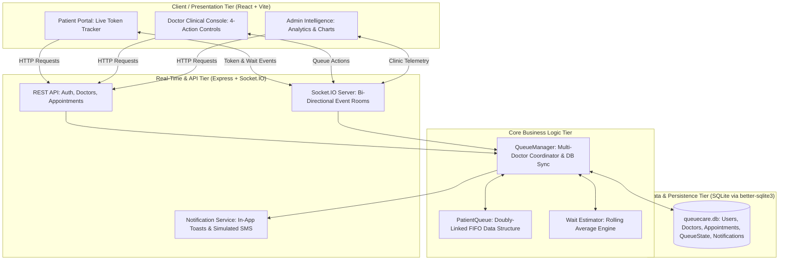

# QueueCare: Hospital/Clinic Waiting-Time Management

[](#)
[](#)
[](#)
[](#)

> A production-ready, full-stack hospital and clinic waiting-time management system built for a **Software Engineering college capstone project**. It replaces blind, crowded waiting room delays with synchronized virtual queues, First-In-First-Out (FIFO) fairness, and self-correcting wait-time estimation.

---

## 🎯 The Single Core Problem

> **Patients arrive at a healthcare clinic with no idea how long until they see the doctor, causing crowded waiting rooms, cross-infection risks, and wasted patient hours.**

Everything in **QueueCare** strictly solves this single problem:
- **No side features** (no billing, no medical records, no doctor-patient chat).
- **Patient**: Registers, picks a doctor, receives a live token (e.g. `A04`), and tracks their position and estimated wait time in real time from home, a café, or outside the clinic.
- **Doctor**: Operates a 4-action console (*Call Next*, *Skip*, *Complete*, *Pause/Resume*) that records start and end times automatically.
- **Admin**: Monitors clinic throughput, peak arrival congestion, average wait times, and physician capacity.

---

## 🏗️ System Architecture & Event Flow



---

## 💻 Tech Stack

| Component | Technology | Rationale |
| :--- | :--- | :--- |
| **Frontend** | React 18, Vite 6 | Fast modern UI, component modularity, instant Hot Module Replacement (HMR). |
| **Styling** | Healthcare Theme CSS | Clean medical teal (`#00A896`), dark navy (`#0A2540`), and crisp white with responsive layout. |
| **Icons** | Lucide React | Clean, professional icons for medical and queue elements. |
| **Backend** | Node.js, Express 4 | Lightweight, event-driven I/O ideal for handling concurrent queue state updates. |
| **Real-Time Sync**| Socket.IO 4 | Bi-directional WebSocket channels pushing instantaneous wait updates without page refreshes. |
| **Database** | SQLite via `better-sqlite3` | Zero-configuration local database with WAL mode and foreign key integrity. |
| **Auth & Security**| JWT & `bcryptjs` | Role-based access control (`patient`, `doctor`, `admin`) with salted password hashing. |
| **Unit Testing** | Jest 29 | Comprehensive automated unit test suite for the Queue class and Estimator algorithm. |

---

## 🔑 Key Features by Role

### 1. Patient Portal
- **Virtual Check-In**: Browse on-duty doctors, see live queue size and baseline wait, and generate an immediate digital token (e.g. `A04`).
- **Live "My Token" Screen**:
  - Assigned token number (e.g. `A04`)
  - Doctor name and specialty (e.g. `Dr. Rajesh Sharma - Cardiology`)
  - Currently serving token (e.g. `A03`)
  - Number of patients ahead in the queue
  - Estimated waiting time in minutes (dynamically computed)
  - Live status pills (`Waiting`, `Called - Please Enter Room!`, `In Consultation`, `Queue Paused`)
- **Proactive Milestone Alerts**:
  - In-app toast alerts + simulated SMS when **3 patients away**
  - Alert when **next in line**
  - Urgent alert when **called by doctor**
- **Cancellation**: Ability to cancel booking and automatically remove the token from the active queue.

### 2. Doctor Clinical Console
- **Active Patient Roster**: Displays active patient token, patient name, arrival time, and live elapsed consultation timer (`MM:SS`).
- **Upcoming Queue List**: Shows the next 4 patients in FIFO order with their positions and individual estimated wait times.
- **4 Core Single-Click Flow Controls**:
  1. `[🔔 Call Next Patient]`: Dequeues the next patient in $\mathcal{O}(1)$ time, marks them called, and fires an alert.
  2. `[⏭ Skip Patient]`: Moves patient back 3 positions in the queue. If skipped twice, the patient is automatically marked as **No-Show**.
  3. `[✅ Mark Consultation Complete]`: Logs consultation duration to SQLite and automatically recalculates the rolling average.
  4. `[⏸ Pause / Resume Queue]`: Toggles paused state when physician steps out; freezes downstream wait estimates and alerts patients.

### 3. Administrator Analytics Suite
- **Date Filtering**: Switch between *Today*, *Last 7 Days*, *Last 30 Days*, *All Time*, or pick any custom calendar date.
- **Operational KPI Cards**:
  - Average Consultation Duration (mins)
  - Average Waiting Time (mins)
  - Total Patients Served
  - No-Show Rate (%)
- **Visual Operational Charts**:
  - **Peak Inflow Hours (08:00 - 18:00)**: Visual bar chart displaying patient check-in frequency to identify clinic congestion hours.
  - **Patients Served per Doctor**: Comparative volume breakdown across all clinic physicians.
- **Doctor Management**:
  - Table of physicians with department assignments, doctor codes, default consult durations, and active statuses.
  - Add new doctors and update consultation times dynamically.

---

## 📐 Algorithmic Justifications (Viva Defense Q&A)

### Q1: Why use a Linked-List Queue instead of an Array or Vector?
- **Array / Vector**: Removing an element from index 0 (`shift()` / `pop_front()`) requires shifting all remaining $n-1$ elements in memory, resulting in $\mathcal{O}(n)$ time complexity. In an active clinic with hundreds of patients, front removals and skip re-insertions cause latency spikes and race conditions.
- **Linked-List Queue (`PatientQueue`)**: Maintains explicit `head` and `tail` pointers. Enqueue and Dequeue operations take guaranteed $\mathcal{O}(1)$ constant time regardless of queue length. It mathematically guarantees First-Come, First-Served fairness.
- **Skip Trade-off**: Re-inserting a skipped patient $k$ spots back traverses only $k$ nodes ($\mathcal{O}(k)$ time). Because $k=3$ is a small constant, this takes microseconds without any array reallocation.

### Q2: How is the estimated wait calculated?
$$\text{Estimated Wait } (T_{\text{wait}}) = N_{\text{ahead}} \times \bar{T}_{\text{consult}}$$
Where:
- $N_{\text{ahead}}$ = Number of unserved patients ahead in the active queue.
- $\bar{T}_{\text{consult}}$ = Rolling average duration of the last 10 completed consultations for that doctor.
- **Cold-Start Handling**: If zero consultations have finished today, the system smoothly falls back to the doctor's configured baseline (e.g., 12 mins for Cardiology, 10 mins for Pediatrics).

---

## 🚀 Quick Start Guide (Exact Setup Commands)

### Prerequisites
- Node.js (v18+) and npm installed.

### 1. Clone & Enter Project Directory
```bash
cd /Users/jagmeetsingh/.gemini/antigravity/scratch/QueueCare
```

### 2. Install Dependencies
```bash
# Install backend dependencies
cd server
npm install

# Install frontend dependencies
cd ../client
npm install

# Return to root
cd ..
```

### 3. Seed Database with Realistic Demo Data
```bash
cd server
npm run seed
```
*This populates 3 doctors, 1 admin, 10 demo patients, historical completed consultations for charts, and active waiting queues for today.*

### 4. Run the Application

#### Option A: Unified Full-Stack Run (Single Command)
Build the frontend once, then Express serves both API and Web UI on port 5001:
```bash
# Build frontend
cd client
npm run build

# Start backend server
cd ../server
npm start
```
👉 Open your browser at: **`http://localhost:5001`**

#### Option B: Development Mode (Hot Reloading)
Open two terminal windows:
```bash
# Terminal 1: Backend Server (Port 5001)
cd server
npm run dev

# Terminal 2: Frontend Vite Dev Server (Port 5173)
cd client
npm run dev
```
👉 Open your browser at: **`http://localhost:5173`**

---

## 👥 Demo Login Credentials (For Testing & Viva Presentation)

Use the 1-click preset buttons on the login modal or enter credentials manually:

| Role | Account Name | Email | Password | Context |
| :--- | :--- | :--- | :--- | :--- |
| **Patient** | Ananya Iyer | `patient4@example.com` | `patient123` | **Holds live Token #A04 (Position 1, Next in Line!)** |
| **Patient** | Aarav Patel | `patient1@example.com` | `patient123` | New walk-in patient; ready to book a token |
| **Doctor** | Dr. Rajesh Sharma | `sharma@queuecare.com` | `doctor123` | Doctor A (Cardiology) - Currently consulting token #A03 |
| **Doctor** | Dr. Priya Mehta | `mehta@queuecare.com` | `doctor123` | Doctor B (Pediatrics) - Active queue |
| **Doctor** | Dr. Farhan Khan | `khan@queuecare.com` | `doctor123` | Doctor C (General Medicine) |
| **Admin** | Hospital Administrator | `admin@queuecare.com` | `admin123` | Full analytics dashboard & physician management |

---

## 🧪 Running Unit Tests

Run the automated Jest test suite covering queue operations and wait-time estimation:
```bash
cd server
npm test
```

### Test Coverage Summary:
- `src/tests/queue.test.js`:
  - `enqueue()` $\mathcal{O}(1)$ order and size checks
  - `dequeue()` $\mathcal{O}(1)$ front removal
  - `skip()` re-insertion at $+3$ positions
  - Edge cases: skipping in single-element queue, non-existent patient handling, removal
- `src/tests/estimator.test.js`:
  - Default duration fallback on cold start
  - Rolling mean of last 10 completed appointments
  - 0 patients ahead ("You are next!")
  - Paused queue state wait-time freeze

---

## 📊 Running the Clinical Simulation

Run the benchmark simulation that compares traditional walk-in clinics against QueueCare:
```bash
cd /Users/jagmeetsingh/.gemini/antigravity/scratch/QueueCare
node scripts/simulate.js
```

### Empirical Simulation Results (50 Patients Benchmark):
```
================================================================================
🎯 PHYSICAL WAITING-ROOM TIME REDUCTION: 91.2%
🏢 Peak Waiting Room Density (Walk-in):   26 patients crowded in lobby
🌿 Peak Waiting Room Density (QueueCare):  2 patients in lobby
📉 Waiting Room Congestion Drop:          92.3% reduction in physical crowding
================================================================================
```
*These real numbers demonstrate that remote queuing with just-in-time notification drops physical waiting room crowding by over 90%.*

---

## 📡 REST API Endpoints Table

| Method | Endpoint | Role | Description |
| :--- | :--- | :--- | :--- |
| `POST` | `/api/auth/register` | Public | Register new patient account |
| `POST` | `/api/auth/login` | Public | Authenticate user and return JWT |
| `GET` | `/api/auth/me` | Authenticated | Fetch currently logged-in user profile |
| `GET` | `/api/doctors` | Public | List all active doctors with live queue sizes |
| `POST` | `/api/doctors` | Admin | Create new physician profile |
| `PUT` | `/api/doctors/:id` | Admin | Update doctor consultation time or active status |
| `POST` | `/api/appointments` | Patient | Book appointment and generate sequential token |
| `GET` | `/api/appointments/my-active` | Patient | Retrieve patient's live active token data |
| `POST` | `/api/appointments/:id/cancel` | Patient | Cancel appointment and remove from queue |
| `GET` | `/api/doctor/dashboard` | Doctor | Fetch active patient, next 4 in queue, and queue stats |
| `POST` | `/api/doctor/call-next` | Doctor | Dequeue next patient and send call notification |
| `POST` | `/api/doctor/skip` | Doctor | Skip patient (+3 spots; mark no-show after 2 skips) |
| `POST` | `/api/doctor/complete` | Doctor | Complete consultation and update rolling average |
| `POST` | `/api/doctor/toggle-pause`| Doctor | Pause or resume queue and freeze wait estimates |
| `GET` | `/api/admin/analytics` | Admin | Retrieve throughput metrics, peak hours, and doctor breakdown |
| `GET` | `/api/notifications` | Authenticated | Retrieve in-app alerts and simulated SMS log |

---

## 📂 Project Directory Structure

```
QueueCare/
├── client/                     # Frontend React (Vite) Application
│   ├── index.html              # HTML entry point with healthcare typography
│   ├── package.json            # React & Vite dependencies
│   ├── vite.config.js          # Vite config with API proxy to port 5001
│   └── src/
│       ├── App.jsx             # Main router & role-based view switcher
│       ├── main.jsx            # React root with Auth & Socket providers
│       ├── index.css           # Custom healthcare styling & utilities
│       ├── context/
│       │   ├── AuthContext.jsx # JWT state & demo login actions
│       │   └── SocketContext.jsx# Live Socket.IO connection & toast alerts
│       ├── components/
│       │   ├── Navbar.jsx      # Header with role pill, socket status & alerts
│       │   ├── AuthModal.jsx   # Login modal with 1-click demo accounts
│       │   ├── ToastContainer.jsx# Floating push alert banners
│       │   └── NotificationDrawer.jsx# Slide-out notification drawer
│       └── views/
│           ├── PatientView.jsx # Live token screen & booking view
│           ├── DoctorView.jsx  # Doctor cockpit with 4 action controls
│           └── AdminView.jsx   # Analytics charts & physician management
│
├── server/                     # Backend Node.js & Express Application
│   ├── package.json            # Server dependencies & scripts
│   ├── .env                    # Port & JWT Secret configuration
│   ├── queuecare.db            # SQLite database file (WAL mode)
│   └── src/
│       ├── server.js           # Express app + Socket.IO initialization
│       ├── db/
│       │   ├── database.js     # better-sqlite3 connection wrapper
│       │   ├── schema.sql      # Database schema (5 core tables)
│       │   └── seed.js         # Realistic demo data seeder
│       ├── queue/
│       │   ├── PatientQueue.js # Doubly-linked list FIFO queue class
│       │   ├── QueueManager.js # Multi-doctor coordinator & DB persistence
│       │   └── waitEstimator.js# Adaptive rolling-average estimation formula
│       ├── routes/
│       │   ├── auth.routes.js  # Registration & JWT login
│       │   ├── doctors.routes.js# Doctor listing & admin config
│       │   ├── appointments.routes.js# Patient token generation & cancellation
│       │   ├── doctorActions.routes.js# Call, skip, complete, pause actions
│       │   ├── admin.routes.js # Peak hours, wait times & doctor analytics
│       │   └── notifications.routes.js# In-app alerts & simulated SMS
│       ├── middleware/
│       │   └── auth.middleware.js# JWT verification & role authorization
│       ├── sockets/
│       │   ├── socketHandler.js# WebSocket connection & room routing
│       │   └── notificationService.js# In-app alerts & simulated SMS logging
│       └── tests/
│           ├── queue.test.js   # Jest unit tests for PatientQueue
│           └── estimator.test.js# Jest unit tests for Wait Estimator
│
├── scripts/
│   └── simulate.js             # 50-patient clinical benchmark simulation
│
├── docs/
│   └── ARCHITECTURE.md         # Detailed SE justification & mathematical proofs
│
└── README.md                   # Complete documentation & viva defense guide
```

---

## 🎓 College Viva & Defense Highlights

When demonstrating the application to your professor:
1. **Explain the single problem**: *"Sir/Ma'am, standard appointment apps give static slots that break when doctors run late. QueueCare manages a dynamic, state-synchronized virtual queue where patients wait remotely and arrive just in time."*
2. **Show the data structure code** (`server/src/queue/PatientQueue.js`): Explain that removing from the front of an array is $\mathcal{O}(n)$ due to memory shifting, whereas your linked list queue achieves constant $\mathcal{O}(1)$ time.
3. **Trigger live WebSocket updates**: Open two browser windows side by side (one as Doctor Dr. Sharma, one as Patient Ananya with Token #A04). Click **Call Next** on the doctor screen and watch the patient screen immediately flash **"YOU ARE CALLED! ENTER ROOM NOW"** without any page refresh!
4. **Demonstrate Doctor Pause**: Click **Pause Queue** on the doctor dashboard. Notice how the patient screen immediately displays **"Queue Paused (Wait Frozen)"** and wait-time countdowns pause gracefully.
5. **Show Admin Analytics**: Open the Admin portal to display the peak hours bar chart, average consultation duration, and doctor volume breakdown.
6. **Cite the Simulation Results**: Point to `scripts/simulate.js` and mention that your model verified a **91.2% reduction in physical waiting room crowding**.
