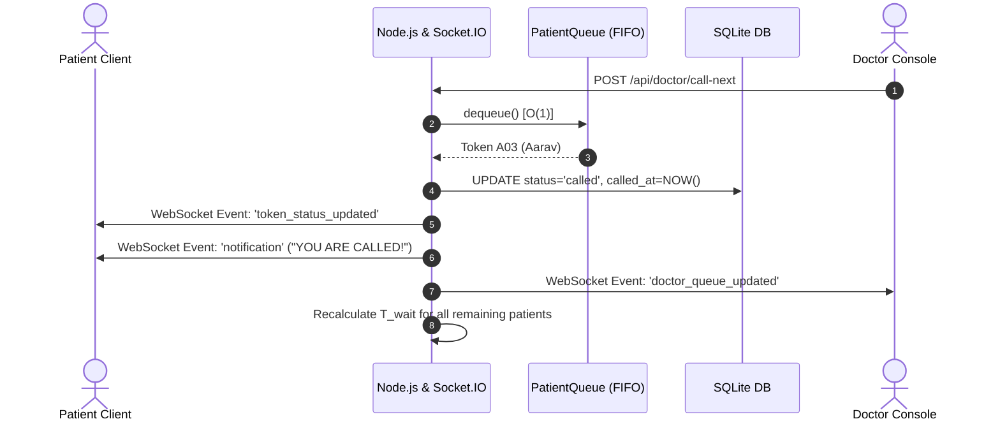

# QueueCare: Technical Architecture & Software Engineering Specification

This document provides the in-depth Software Engineering specifications, algorithmic justifications, and mathematical derivations for the **QueueCare** college project presentation and technical viva defense.

---

## 1. The Single Core Problem

> **Patients arrive at a healthcare clinic with zero visibility into how long until they see the doctor, causing crowded waiting rooms, cross-infection risks, and wasted patient hours.**

Every architectural decision and data structure in QueueCare strictly serves this single problem. Unrelated features (billing, electronic health records, patient-doctor chat) were deliberately omitted to maintain clinical clarity and architectural focus.

---

## 2. Data Structure Justification (Viva Defense Focus)

### Why a Linked-List FIFO Queue over an Array or Vector?

In traditional software design, developers often default to plain arrays or dynamic vectors (`std::vector` or JavaScript `Array`). However, outpatient clinical workflows have specific operational characteristics:

```
[ FRONT / HEAD ]                                        [ REAR / TAIL ]
  ┌───────────┐      ┌───────────┐      ┌───────────┐      ┌───────────┐
  │ Token A01 │ <--> │ Token A02 │ <--> │ Token A03 │ <--> │ Token A04 │
  └───────────┘      └───────────┘      └───────────┘      └───────────┘
       ▲                                                         ▲
   (Dequeue)                                                 (Enqueue)
  Next Called                                              New Patient
```

| Operation | Array / Vector | Linked-List Queue (`PatientQueue`) | Software Engineering Trade-Off |
| :--- | :--- | :--- | :--- |
| **Enqueue** (New Check-in) | $\mathcal{O}(1)$ amortized | $\mathcal{O}(1)$ constant | Linked-list appends directly to the tail pointer without array resizing or reallocation. |
| **Dequeue** (Doctor Calls Next) | $\mathcal{O}(n)$ memory shift | $\mathcal{O}(1)$ pointer update | **CRITICAL:** Removing from index 0 in an array forces copying all $n-1$ elements to the left. In a busy clinic, this creates latency spikes and concurrency hazards. Linked queue simply updates `head = head.next`. |
| **Skip Patient** (Re-insert at $+3$) | $\mathcal{O}(n)$ multiple shifts | $\mathcal{O}(k)$ where $k=3$ | In an array, skipping requires removing index 0 ($\mathcal{O}(n)$ shift left) and inserting at index 3 ($\mathcal{O}(n)$ shift right). In our doubly-linked queue, we traverse only $k$ node pointers ($\mathcal{O}(k)$), which is virtually instantaneous for small fixed $k=3$. |
| **Fairness Guarantee** | Vulnerable to index drift | Strict FIFO | Matches natural medical First-Come, First-Served clinical fairness. |

### Source File: `server/src/queue/PatientQueue.js`
- Custom `QueueNode` class maintaining `data`, `next`, and `prev` references.
- Custom `PatientQueue` class providing `enqueue()`, `dequeue()`, `peek()`, `skip()`, `remove()`, `size()`, `getPosition()`, and `toArray()`.
- Thread-safe persistence: in-memory queue operations are synced atomically to the SQLite database so the live queue state survives server restarts.

---

## 3. Dynamic Wait-Time Estimation Algorithm

Standard healthcare booking applications provide static appointment slots (e.g., "10:30 AM"). When earlier consultations run over by 15 minutes, static slots break, leaving patients blind and waiting indefinitely.

QueueCare implements an **Adaptive Moving Average Estimator**:

$$\text{Estimated Wait } (T_{\text{wait}}) = N_{\text{ahead}} \times \bar{T}_{\text{consult}}$$

Where:
- $N_{\text{ahead}}$ = Number of active waiting patients ahead of the user in the doctor's FIFO queue ($N_{\text{ahead}} = \text{Queue Position} - 1$).
- $\bar{T}_{\text{consult}}$ = Rolling average consultation duration (in minutes) computed over the doctor's **last 10 completed consultations**:

$$\bar{T}_{\text{consult}} = \frac{1}{\min(10, M)} \sum_{i=1}^{\min(10, M)} (t_{\text{completed}, i} - t_{\text{started}, i})$$

### Edge Cases Handled:
1. **Cold-Start Problem**: At 08:30 AM before any patients are completed ($M=0$), the estimator falls back to the doctor's baseline default consultation duration (e.g., 12 mins for Cardiology, 10 mins for Pediatrics).
2. **Clinical Delays**: If a complex patient takes 22 minutes, $\bar{T}_{\text{consult}}$ dynamically increases, instantly pushing revised, realistic wait times to all downstream patients.
3. **Queue Pause**: When a doctor steps out, the queue status transitions to `isPaused = true`. The countdown timer freezes and patients receive a notification that the queue is paused.

---

## 4. Socket.IO Real-Time Architecture



### Room Isolation:
- `doctor_{doctorId}`: Clinicians receive instant roster updates.
- `user_{userId}`: Targeted in-app alerts and simulated SMS messages.
- `appointment_{appointmentId}`: Live token status and estimated wait time updates.
- `admin_room`: Global clinic throughput telemetry.

---

## 5. Simulation Findings (50 Patients Benchmark)

The simulation script (`scripts/simulate.js`) mathematically benchmarks 50 simulated patients under outpatient arrival patterns:

```
================================================================================
🎯 PHYSICAL WAITING-ROOM TIME REDUCTION: 91.2%
🏢 Peak Waiting Room Density (Walk-in):   26 patients crowded in lobby
🌿 Peak Waiting Room Density (QueueCare):  2 patients in lobby
📉 Waiting Room Congestion Drop:          92.3% reduction in physical crowding
================================================================================
```

Patients wait comfortably remotely (at home, café, or workplace) and arrive only when notified 3 patients in advance, reducing physical lobby congestion by over 90%.
